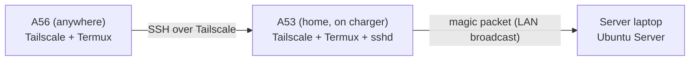

# wake-on-lan-tailscale
here i will show you how i configured wol on my home server

# Wake my home server from anywhere: Wake-on-LAN + Tailscale + a spare phone

I run a small Ubuntu Server on an old laptop (called `homeserver` in this guide) and let it sleep when I don't need it. This guide shows how I wake it from anywhere with one command on my phone. No port forwarding, no cloud service, no extra hardware.

**The catch:** a Wake-on-LAN "magic packet" only works inside the local network, and a sleeping laptop is not on my Tailscale network either. So a spare phone stays at home on the charger as a relay. From my everyday phone I SSH into the relay over Tailscale, and the relay sends the magic packet to the laptop.



| Device | Role | Tailscale IP (yours will differ) |
|---|---|---|
|Galaxy A53 | stays at home on the charger, sends the magic packet | `100.107.77.17` |
|Galaxy A56 | my remote control, goes everywhere with me | `100.72.187.86` |
|Ubuntu Server (laptop) | gets woken up | `100.74.193.68` |

**Placeholders used below:** `SERVER_USER` is your login on the server, `PHONE_USER` is the output of `whoami` in Termux on the A53, and `AA:BB:CC:DD:EE:FF` is the server's MAC address.

> **Privacy note:** this write-up is sanitized on purpose. Account names, avatars, device names, the server hostname, the MAC address and the BIOS serial numbers are blurred or replaced in the screenshots, and the text uses placeholders for usernames and the MAC address. Tailscale `100.x` addresses are only reachable from inside a tailnet, so I left them in.

## What you need

- A server with a wired ethernet connection (Wake-on-LAN generally does not work over Wi-Fi)
- Two Android phones with [Tailscale](https://tailscale.com/) and [Termux](https://termux.dev/), one of which can stay at home on a charger
- A free Tailscale account (I signed in with GitHub)

## 1. Prepare the server

### 1.1 Check the BIOS

My BIOS (AMI Aptio) has **no Wake-on-LAN option** at all. That turned out not to matter, because WoL can be enabled from the operating system (step 1.3). It is still worth a look. The Main screen shows the MAC address you need (blurred here).

<details>
<summary>BIOS screens</summary>

| Main | Advanced | Boot | Security |
|---|---|---|---|
|   |  |  |  |

</details>

### 1.2 Find the interface name and MAC address

```bash
ip link
```

Look for your wired interface (mine is `enp2s0f1`) and the `link/ether` address next to it.

### 1.3 Enable Wake-on-LAN in Ubuntu

```bash
sudo apt install ethtool
sudo ethtool enp2s0f1 | grep -i wake
```

You want to see `Wake-on: g`. If you see `d`, enable it:

```bash
sudo ethtool -s enp2s0f1 wol g
```

That setting is lost on reboot, so make it permanent with a small systemd service:

```bash
sudo tee /etc/systemd/system/wol.service > /dev/null << 'EOF'
[Unit]
Description=Enable Wake-on-LAN
After=network.target

[Service]
Type=oneshot
ExecStart=/usr/sbin/ethtool -s enp2s0f1 wol g

[Install]
WantedBy=multi-user.target
EOF

sudo systemctl daemon-reload
sudo systemctl enable --now wol.service
```

Check the path with `which ethtool` and replace `enp2s0f1` with your interface name.

### 1.4 Put the server on your tailnet

```bash
sudo snap install tailscale
sudo tailscale up
```

(The official install script from tailscale.com works too.) `tailscale up` prints a login link, so sign in with the same account as the phones.

In the Tailscale admin console, open the menu next to the server (and later the A53) and choose **Disable key expiry**, so they never drop off your network.

## 2. Set up the relay phone (A53)

### 2.1 Tailscale

Install Tailscale, sign in and approve the device. I used GitHub as the login method.

| Authorize | Connect device | Login successful |
|---|---|---|
|  |  |  |

### 2.2 Termux and SSH

Install Termux. I recommend the F-Droid build, and if you want Termux:Boot later it must come from the same source as Termux itself. Then:

```bash
pkg update && pkg upgrade
pkg install -y openssh python
```


Set a password, start the SSH server and check your username:

```bash
passwd
sshd
whoami
```


Termux's SSH server listens on port **8022**. Note the username `whoami` prints (something like `u0_a160`). That is your `PHONE_USER`.

### 2.3 The magic packet script

Create `~/wol.py` on the A53. Fill in your server's MAC address and your LAN's broadcast address (usually the router's address with `.255` at the end):

```bash
cat > ~/wol.py << 'EOF'
import socket

MAC = "AA:BB:CC:DD:EE:FF"     # MAC address of the server
BROADCAST = "192.168.1.255"   # broadcast address of your home network

packet = b"\xff" * 6 + bytes.fromhex(MAC.replace(":", "")) * 16

with socket.socket(socket.AF_INET, socket.SOCK_DGRAM) as s:
    s.setsockopt(socket.SOL_SOCKET, socket.SO_BROADCAST, 1)
    s.sendto(packet, (BROADCAST, 9))

print("Magic packet verstuurd")  # Dutch for "magic packet sent"
EOF
```

Test it locally while the server is asleep: `python ~/wol.py`. If the laptop wakes up, the hard part is done.

### 2.4 Keep it alive

The only real risk is Android killing Termux or Tailscale in the background.

- Keep the A53 **on the charger, on your home Wi-Fi**. On Samsung, turn on **Settings → Battery → Battery protection** so charging stops at 85%.
- In **Settings → Apps**, set the battery setting for **Termux** and **Tailscale** to **Unrestricted**.
- Open **Settings → Battery → Background usage limits** (screenshot below). Make sure Termux and Tailscale are not in *Sleeping apps* or *Deep sleeping apps*.
- In the recent apps screen, tap the Termux icon and choose **Keep open** (lock), and never swipe it away.
- Turn on **Always-on VPN** for Tailscale under **Settings → Connections → VPN** (the name varies per One UI version).
- In Termux, run this and leave the app open:

```bash
termux-wake-lock
sshd
```


*My screenshot is in Dutch: "Ongebruikte apps laten sluimeren" is switched off, and the lists show 1 sleeping and 9 deep-sleeping apps. Check those lists on your phone.*

Also give the A53 and the server a fixed address with a DHCP reservation in your router.

### 2.5 After a reboot or power cut

`termux-wake-lock` and `sshd` do not survive a restart. Open Tailscale (it must say *Connected*), then open Termux and run the two commands again. The Termux:Boot app can automate this, but only with a matching Termux source (see 2.2).

## 3. Set up the remote phone (A56)

Install Tailscale (same account) and Termux, then:

```bash
pkg install -y openssh
ssh-keygen -t ed25519 -f ~/.ssh/id_ed25519 -N ""
```

Copy the key to the A53. Run this **one command on its own**, with your own username and the A53's Tailscale IP:

```bash
cat ~/.ssh/id_ed25519.pub | ssh -p 8022 PHONE_USER@100.107.77.17 "mkdir -p ~/.ssh && cat >> ~/.ssh/authorized_keys && chmod 700 ~/.ssh && chmod 600 ~/.ssh/authorized_keys"
```

The first connection asks whether you trust the host. Type `yes`, then enter the password you set with `passwd`.


> **Username note:** in my test the connection also worked with a made-up username (`u0_aXXX`), so Termux's SSH server does not seem to check it. I still use the real `whoami` output to avoid confusion.

Now create the one-word command that wakes the server:

```bash
cat > ~/wake.sh << 'EOF'
#!/data/data/com.termux/files/usr/bin/sh
ssh -p 8022 PHONE_USER@100.107.77.17 "python ~/wol.py"
EOF
```

## 4. Wake the server

1. Turn on Tailscale on the A56. Wi-Fi can be off, mobile data is fine.
2. Open Termux and run:

```bash
sh ~/wake.sh
```

You should see `Magic packet verstuurd`. Before the wake-up, the server shows as offline (grey) in the Tailscale app:

| Server offline | Packet sent |
|---|---|
| 
|  |

3. Wait 1 to 2 minutes until the server turns green in Tailscale, then connect:

```bash
ssh SERVER_USER@100.74.193.68
```

From a Windows PC with Tailscale, the same trick works in PowerShell:

```powershell
ssh -p 8022 PHONE_USER@100.107.77.17 "python ~/wol.py"
```

## 5. Turning the server off again

From the A56, in one command (you type the server password afterwards):

```bash
ssh -t SERVER_USER@100.74.193.68 "sudo poweroff"
```

The connection drops immediately, which is normal. Or put it to sleep, which wakes faster:

```bash
sudo systemctl suspend
```

> **Suspend vs. shutdown:** on my laptop (Realtek NIC, `r8169` driver) waking works from a full power-off as well as from suspend. That is not guaranteed on every machine, so test both before you rely on it. The laptop also suspends when you close the lid.

## Troubleshooting

| Problem | What to check |
|---|---|
| `wake.sh` gives no connection | Is Tailscale on for both phones? Is `sshd` running in Termux on the A53? |
| `Permission denied` on `wake.sh` | Run `chmod +x ~/wake.sh`, or start it with `sh ~/wake.sh`. |
| `No 'su' binary found` | Don't use `sudo` in Termux, it needs a rooted phone. You don't need it here. |
| `Host key verification failed` | Run the `ssh` command alone and type `yes` at the prompt. Pasting several lines at once can answer the prompt for you. |
| Command contains `GEBRUIKER` or `PHONE_USER` | You forgot to replace the placeholder with your own username. |
| Packet sent, laptop stays off | On the server `ethtool` must show `Wake-on: g`. Is the cable in, do the port LEDs stay on during suspend? |
| Laptop is awake but unreachable | Wait longer, Tailscale comes back only after boot. Check the admin console. |
| A53 stops responding | Android probably killed Termux or Tailscale. Reopen them and recheck the battery settings (2.4). |

<details>
<summary>Screenshots of the errors I ran into</summary>

| Placeholder not replaced, host key prompt skipped | `sudo` error and `Permission denied` |
|---|---|
|  |  |

</details>

## Security notes

- Your tailnet is tied to your **GitHub account**, so turn on 2FA there (ideally with a passkey).
- The SSH key on the A56 has **no passphrase**. Keep the phone locked, and if you lose it, delete it right away in the admin console (**⋯ → Delete**).
- Turn **key expiry back on** for the A56 (**⋯ → Enable key expiry**), so its access expires by itself. Keep it off for the A53 and the server.
- Check the **Machines** page in the admin console now and then for devices you don't recognise.
- Later, switch SSH on the server and the A53 from passwords to keys.
- Nothing is exposed to the internet: all traffic goes through Tailscale, and the magic packet never leaves your home network.

## Quick reference

- Wake: `sh ~/wake.sh` (on the A56)
- Connect: `ssh SERVER_USER@100.74.193.68`
- WoL service on the server: `wol.service`
- Relay script on the A53: `~/wol.py`
- Wake script on the A56: `~/wake.sh`
